# TaiJiAura · 1.0

## 中文简介

### 功能介绍

TaiJiAura 是一款 Windows 原生桌面监控工具，通过透明悬浮胶囊实时展示 CPU、内存、GPU、独立显存、系统支持的温度数据及上传下载速度，让你在工作、学习或游戏时，随时了解电脑的运行状态，无需频繁切换到其他监控窗口。

你可以按需选择两至四项硬件读数，切换显示屏、调整大小和动画帧率，并在中文与英文菜单之间切换。胶囊靠近屏幕左右边缘后，可自动收起为细长烟流，通过填充高度与颜色变化呈现所选指标，悬停或点击即可展开。

### 设计灵感

灵感源于中国太极文化与水墨艺术。黑白双鱼与八卦意象呼应阴阳流转，水墨的浓淡与留白，将烟的轻盈、混沌的朦胧融入胶囊的动态显示。收起后以柳叶为形、以轻烟为韵，细长微弯，虚实相生，让监控信息在流动中自然呈现。

## English Overview

### Features

TaiJiAura is a native Windows desktop monitor that displays CPU usage, memory usage, GPU activity, dedicated video memory, supported temperature readings, and upload and download speeds in a transparent floating capsule. It keeps your computer's status within easy view while working, studying, or gaming.

Choose two to four hardware metrics, move the widget between monitors, adjust its size and animation frame rates, and switch between Chinese and English menus. When docked to either side of the screen, the capsule can collapse into a slender animated smoke indicator, using its fill height and color to represent the selected reading. Hover over it or click to expand it again.

### Design Inspiration

The design draws inspiration from Chinese Taiji culture and ink-wash painting. A yin-yang symbol and Bagua motifs evoke balance and movement, while soft washes and open space blend the lightness of smoke with a sense of primordial chaos. When collapsed, the indicator takes the slender, gently curved form of a willow leaf and the flowing character of a wisp of smoke.

## 效果展示

### 动画效果类

| 太极烟雾胶囊动画 | 收起烟流动画一 | 收起烟流动画二 |
| :---: | :---: | :---: |
| 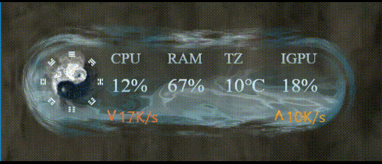 | 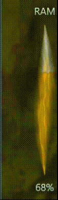 | 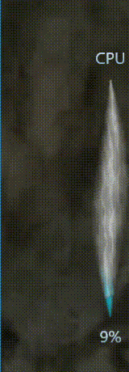 |

### 菜单类

| 胶囊大小设置 | 显示内容选择 | 收起烟流显示内容 |
| :---: | :---: | :---: |
| 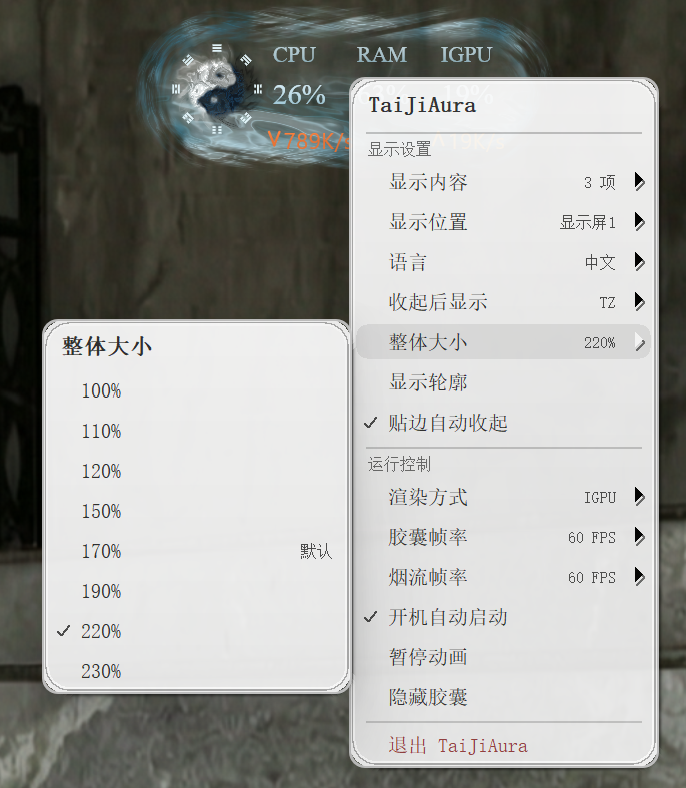 | 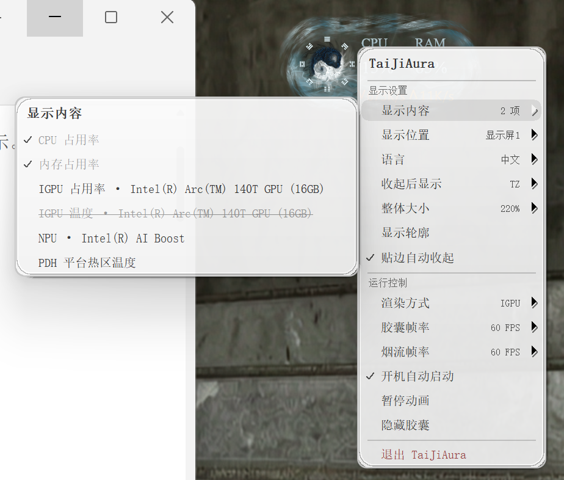 | 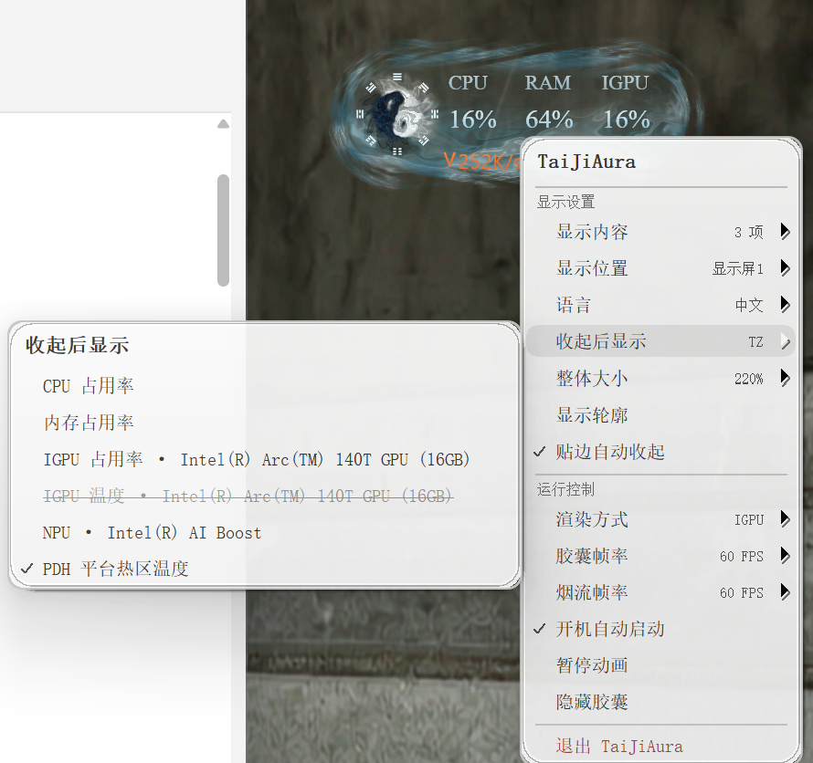 |

### 功能类

| 切换显示屏 | 胶囊帧率控制 | 烟流帧率控制 |
| :---: | :---: | :---: |
| 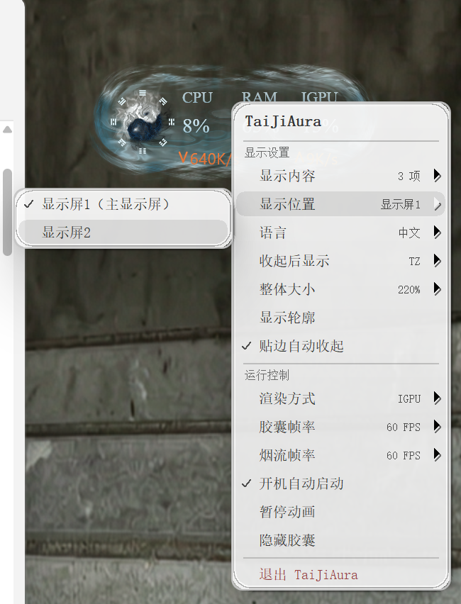 | 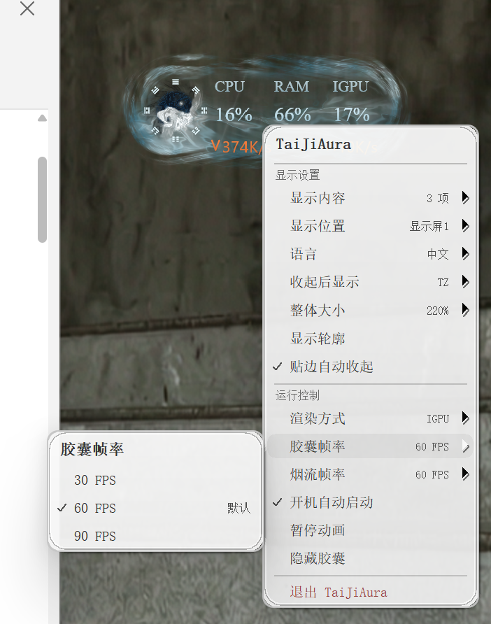 | 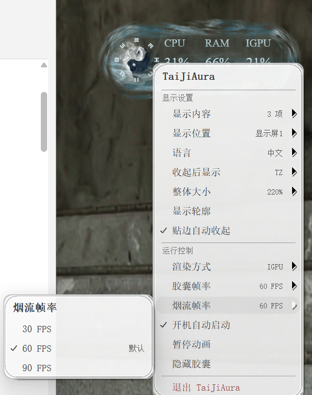 |

### 外观类

| 两项读数显示效果 | 四项读数显示效果 |
| :---: | :---: |
| 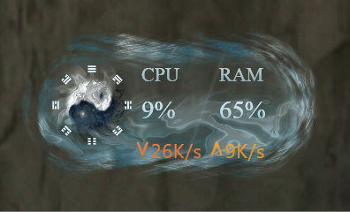 | 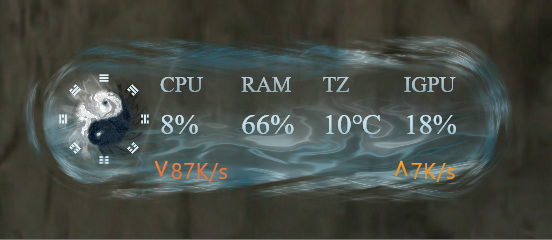 |

## 性能开销

**测试设备**：Intel Core i5-10210U（4 核 8 线程）、12 GB 内存、Windows 10；显卡为 Intel UHD Graphics 和 NVIDIA GeForce MX230，硬件渲染分别测试 Intel UHD 与 MX230。

**测试条件**：170% 大小，在 144 Hz 虚拟显示输出上运行；胶囊显示三项读数和网速，收起烟流显示 CPU。使用复用发布源码的 Release 测量探针，每组预热 1 分钟、连续采样 3 分钟。

以下为进程平均开销，内存采用工作集口径：

| 场景 | CPU | 内存 | GPU 引擎 | 实际 FPS |
| --- | ---: | ---: | ---: | ---: |
| CPU 软件渲染 · 胶囊 | 14.74% | 50.24 MiB | — | 66.21 |
| CPU 软件渲染 · 烟流 | 2.38% | 47.66 MiB | — | 73.16 |
| Intel UHD 渲染 · 胶囊 | 1.04% | 63.90 MiB | 18.74% | 84.28 |
| Intel UHD 渲染 · 烟流 | 0.31% | 58.60 MiB | 5.29% | 84.22 |
| MX230 渲染 · 胶囊 | 1.75% | 58.53 MiB | 6.00% | 84.06 |
| MX230 渲染 · 烟流 | 1.20% | 61.80 MiB | 2.99% | 83.83 |

CPU 以全部 8 个线程合计 100% 计算；GPU 为该进程最忙引擎的占用率，软件渲染行不代表物理 GPU 占用。结果仅供这台设备及上述配置参考。


## 项目介绍

TaiJiAura 是以**太极八卦、黑白双鱼和古风云烟**为视觉主题的 Windows 原生桌面监控工具。透明悬浮胶囊展示实时硬件读数和网速，贴边后可收成细长烟流。

本发布版本为 **1.0**，工程及 Windows 文件版本采用 `1.0.0` / `1.0.0.0`。源码来自最新的 `DesktopBall` 工程，保留现有程序行为，移除独立测试工程、测试构建入口、独立诊断探针及本地构建产物。

## 现有功能

| 功能 | 说明 |
| --- | --- |
| 硬件占用 | CPU、物理内存、集显和独显 GPU 利用率、独显专用显存、系统可识别的 NPU；共享显存不冒充独立显存。 |
| 四项显示 | 同时选择两至四项读数；满四项后替换末项，至少保留两项。调整立即生效并关闭菜单，选择持久化。 |
| 显卡识别 | 按物理设备身份去重，过滤间接显示适配器；不同物理显卡即使同型号也分别保留。 |
| 显卡选择 | GPU 渲染可选择具体物理显卡，集显标识 IGPU，独显依次为 GPU0、GPU1；监控指标沿用同一编号。 |
| 核显温度 | 使用 Windows DXCore 获取已确认核显的温度。不支持时选项置灰并显示删除线；读取失败显示 `-`。不以 CPU、独显或热区读数冒充核显温度。 |
| TZ 平台热区 | 通过 Windows PDH 平台热区计数器提供温度；多个热区取有效最高值。TZ 不代表 CPU 或核显温度，无可用读数时保留缺失状态。 |
| 网速 | 底部固定显示上传与下载，不占用硬件读数名额；支持 B/s、KB/s、MB/s，较长读数自动适配。 |
| 贴边烟流 | 左右贴边自动收起，悬停或点击展开，拖离边缘解除吸附；可单独选择收起指标。 |
| 负载与温度着色 | 占用率映射填充高度；温度按 0～100℃映射，超过 100℃填满。沿用青蓝、绿、金橙、红四色平滑变化，温度读数仍显示 ℃。 |
| 外观与多屏 | 支持轮廓开关、DPI 缩放、多屏切换及屏幕选择保存。大小菜单提供 100%、110%、120%、150%、170%、190%、220%、230%，默认 170%。 |
| 动画与渲染 | CPU 软件渲染（D3D11 WARP）及可用 GPU 渲染；胶囊、烟流分别支持 30 / 60 / 90 FPS，默认 60 FPS。 |
| 中英文与托盘 | 中文 / English 菜单，托盘、隐藏、暂停动画、退出及手动控制当前用户开机启动。 |
| 按需采集 | 可见时每秒采集当前显示的指标；隐藏、锁屏、熄屏或系统休眠时停止采集。暂停动画仍采集当前显示数据。 |
| 单实例与配置 | 同一会话仅运行一份；设置保存在程序旁的 `TaiJiAura.ini`，保留原工程已有的旧配置兼容行为。 |

温度与 NPU 等遥测依赖实际设备、驱动和系统接口。不可用数据不以零值或其他设备数据替代。

## 文件结构

```text
E:\TaijiAura\
├─ resources/     README 展示图片和 GIF
├─ scr/           源码工程及构建、打包配置
├─ setup/         打包完成的安装包
├─ .gitignore    
└─ README.md      项目介绍与使用说明
```

## 技术栈

技术栈为 **C++20 + Win32 + Direct3D 11 / HLSL**：Win32 负责悬浮窗口、托盘和菜单，Direct3D 11 与 HLSL 绘制太极和烟雾动画，DirectComposition 完成透明合成，Direct2D / DirectWrite 负责图形与文字显示。硬件数据通过 Windows 原生接口按需采集。

工程使用 **MSVC + CMake + Ninja** 编译，使用 **Inno Setup** 生成中英文安装与卸载向导。着色器在构建时编译嵌入程序，采用静态 MSVC 运行库。

## 编译程序

环境要求：Windows x64、Visual Studio 2022 或更新版本的 MSVC x64 C++ 工具、Windows SDK、CMake 3.25+、Ninja。Visual Studio Installer 中可选择“使用 C++ 的桌面开发”与“用于 Windows 的 C++ CMake 工具”。

在 `E:\TaijiAura` 根目录打开 PowerShell：

```powershell
powershell.exe -NoProfile -ExecutionPolicy Bypass -File .\scr\scripts\build.ps1 -Configuration release -Install
```

自动发现失败或使用自定义工具链路径时，可添加：

```powershell
-VisualStudioPath "D:\Tools\BuildTools"
```

脚本只设置当前进程环境，不修改系统 PATH，不执行程序功能测试。输出位于 `scr/build/release/bin/TaiJiAura.exe`，安装暂存位于 `scr/dist/TaiJiAura.exe`。

也可在已配置 CMake / Ninja 的 **x64 Native Tools** 终端中进入 `scr`：

```powershell
cmake --preset windows-release
cmake --build --preset windows-release
cmake --install build/release
```

## 打包安装程序

额外安装 [Inno Setup](https://jrsoftware.org/isdl.php) 6.5+。在项目根目录运行：

```powershell
powershell.exe -NoProfile -ExecutionPolicy Bypass -File .\scr\scripts\package.ps1 -InnoCompiler "C:\Program Files (x86)\Inno Setup 6\ISCC.exe"
```

支持 `-VisualStudioPath` 指定工具链、`-WorkDirectory` 指定构建暂存目录、`-OutputDirectory` 指定输出位置。默认暂存目录为 `scr/build/packaging`，最终安装包输出到 `setup`。

安装包只包含运行程序与卸载所需文件，不包含个人配置、开发文档或测试程序。

## 安装、语言与路径指引

支持 Windows 10 1809 及以上的 x64 系统和 Windows 11。

1. 双击 `setup/TaiJiAura-1.0-x64-Setup.exe`。
2. 选择“简体中文”或“English”。
3. 在安装位置页面确认目录；默认 `%LOCALAPPDATA%\Programs\TaiJiAura`，面向当前用户安装，默认不要求管理员权限。
4. 点击“浏览 / Browse”可选其他磁盘的专用文件夹，例如 `D:\Apps\TaiJiAura`。不要直接选磁盘根目录。
5. 程序在安装目录写入设置，应选择当前用户可写的位置，避免 `Windows`、`Program Files` 等受保护目录。安装器会检查写入权限。
6. 按需勾选桌面快捷方式；安装结束后可启动。初次安装默认不启用开机自启。

安装向导语言与程序菜单语言分别设置。程序语言在右键菜单中切换；卸载向导沿用安装时的语言。

## 卸载

先从托盘菜单退出程序，再选择以下任一入口：

- 双击安装目录的 **`uninstall.exe`**，按向导确认卸载。
- 开始菜单“TaiJiAura → 卸载 TaiJiAura / Uninstall TaiJiAura”。
- Windows“设置 → 应用 → TaiJiAura → 卸载”。

`uninstall.exe` 调用安装器登记的卸载引擎；请保留同目录的 `unins*.exe` 和 `unins*.dat`。卸载会移除自身程序、快捷方式与应用登记；仅清理仍指向本安装目录的开机启动项，不处理其他副本的启动项。

交互卸载可选择是否删除个人设置，默认保留；静默卸载也保留设置。保留设置时，卸载后目录可能仍存在，便于重新安装沿用配置。

## 致谢

感谢 Windows 与 DirectX 开发工具及文档的维护者，以及 [CMake](https://cmake.org/)、[Ninja](https://ninja-build.org/) 和 [Inno Setup](https://jrsoftware.org/isinfo.php) 等项目，为 TaiJiAura 的开发、构建和分发提供支持。

感谢 Inno Setup 简体中文语言文件的译者，也感谢每一位试用、反馈和提出建议的朋友。
